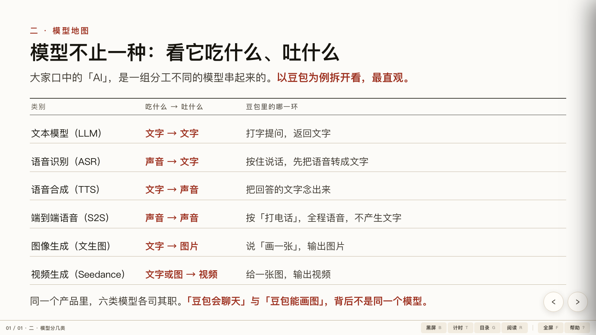
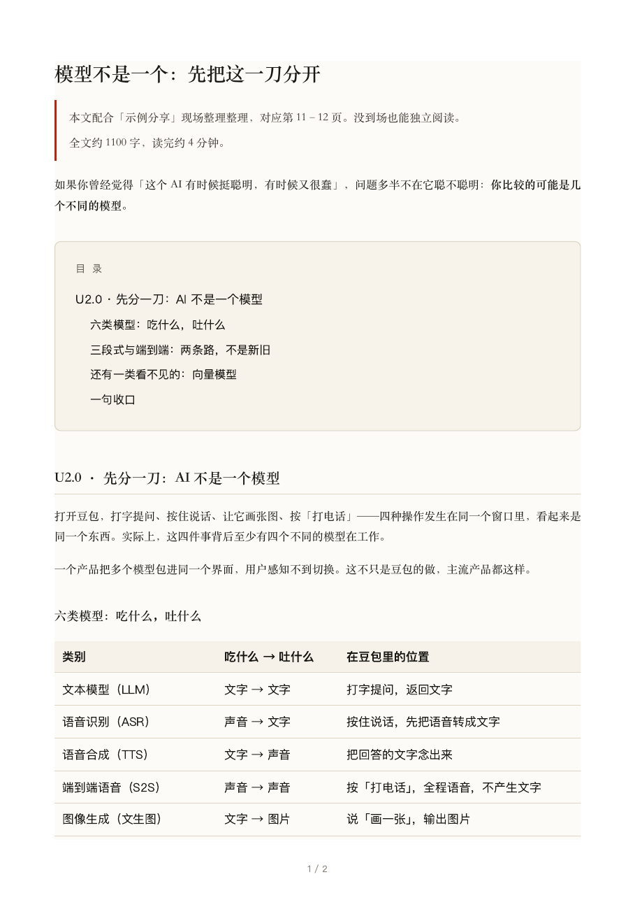
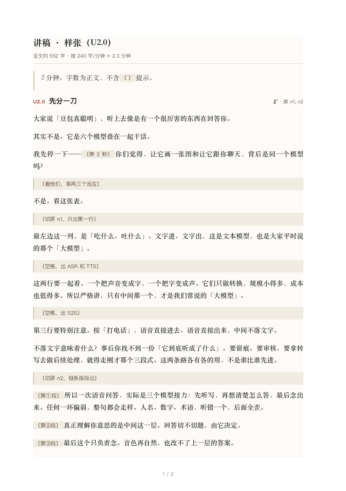

# jing-lecture-skills

<!--brand:sub-->
<sub>晶雕细琢 · 从复杂中找关键，把问题讲清楚</sub>
<!--brand:sub:end-->

把一份内容，做成三份互相咬合的产物：**可投屏的 slides、可发给听众的详细材料、讲者自己拿的讲稿**。

两个 skill 一上一下：

| skill | 输入 | 输出 |
|---|---|---|
| [`lecture-slides`](lecture-slides/) | 一份 `.deck.md` | 单文件 HTML 演示页（分步揭示、演讲者备注、阅读模式，离线可开） |
| [`lecture-pack`](lecture-pack/) | 一份内容清单 + 材料/讲稿 md | 三份产物，外加一次对账 |

`lecture-pack` 负责内容怎么分、三份怎么对齐；`lecture-slides` 负责把幻灯片渲染出来。两者可以单独用，也可以连起来用。

## 效果

**可投屏 slides**（单文件，按空格一行一行出，`S` 拉演讲者备注，`R` 进阅读模式）



**A4 材料**（发给人读的，带目录、表头、页码，链接可点）



**A4 讲稿**（口播句 + 时间 + 现场提示，`〔〕` 标出不能说出口的话）



在线看：

<!--brand:demo-->
- [slides 示例](https://crystalyj37.github.io/jing-lecture-skills/deck.html)（按空格推进）
- [材料 PDF](https://crystalyj37.github.io/jing-lecture-skills/handout.pdf)
- [讲稿 PDF](https://crystalyj37.github.io/jing-lecture-skills/script.pdf)
<!--brand:demo:end-->

## 装法

两个目录**必须并排放在同一个父目录下**——`lecture-pack` 要读 `../lecture-slides/assets/tokens.css` 取配色表。

<!--brand:clone-md-->
```bash
git clone https://github.com/crystalyj37/jing-lecture-skills.git
cp -R jing-lecture-skills/lecture-slides jing-lecture-skills/lecture-pack ~/.workbuddy/skills/
```
<!--brand:clone-md:end-->

只依赖 Python 3 标准库。没有 pip 包，不需要 node。

## 用法

### 只做 slides

```bash
python3 lecture-slides/scripts/build.py talk.deck.md -o talk.html
python3 lecture-slides/scripts/audit.py talk.html   # 退出码非 0 不交付
```

源稿是 markdown，屏幕之间用 `::: screen` 分隔，屏内直接写 HTML：

```markdown
---
title: 示例 · 模型分几类
---

::: screen id=n1 steps=3 title="二 · 模型分几类"
<header class="hd">
  <div class="kicker">二 · 模型地图</div>
  <h2>模型不止一种</h2>
  <p class="lead">看它<strong>吃什么、吐什么</strong>。</p>
</header>
::: note
第一步只出基线，停一下再往下。
:::
:::
```

完整写法见 [`lecture-slides/references/authoring.md`](lecture-slides/references/authoring.md)，组件清单见 [`layouts.md`](lecture-slides/references/layouts.md)。起手先读 [`assets/example.deck.md`](lecture-slides/assets/example.deck.md)。

### 做全套三份

```bash
# 1. 先把内容清单写出来（单元、顺序、每节的目的）
#    模板见 lecture-pack/assets/example/content-map.md

# 2. 材料与讲稿
python3 lecture-pack/scripts/handout.py handout.md -o handout.html --title "示例分享"
python3 lecture-pack/scripts/script.py  script.md  -o script.html

# 3. slides
python3 lecture-slides/scripts/build.py deck.deck.md -o deck.html

# 4. 对账：单元、顺序、数字是否三份一致
python3 lecture-pack/scripts/crosscheck.py content-map.md handout.md script.md deck.deck.md
```

`crosscheck.py` 做的是机械核对：每个单元在不在、顺序对不对、材料里出现的数字在 slides 上有没有出处、有没有留「待补」。它查不出「讲得对不对」，只能查「三份说的是不是同一件事」。

### 打印 PDF

两份 A4 都是 HTML，用 Chrome 打印即可，页眉页码由 `@page` 规则生成，不依赖打印对话框的设置：

```bash
"/Applications/Google Chrome.app/Contents/MacOS/Google Chrome" \
  --headless --no-pdf-header-footer \
  --print-to-pdf=handout.pdf file:///path/to/handout.html
```

## 设计取舍

**内容和版式分开。** `.deck.md` 里只有内容和「这一屏是什么结构」的标记，版式全在 `assets/deck-shell.html`。改一处样式，所有 deck 同时变。

**配色只有一张表。** `lecture-slides/assets/tokens.css`，54 个语义变量，三份产物共用。A4 两份通过一小段别名取不同的墨色与线色，纸面统一为 `#fcfbf8`。壳里不写新的 hex——判据是「换一套配色时它该不该跟着变」。

**分步要自己写 CSS。** `data-step` 不是统一机制，各组件各写各的隐藏规则（`.tr`、`.chain .st`、`.four .c`……）。加新组件时必须同时写 `.x[data-step]{opacity:0}` 和 `.x[data-step].on{opacity:1}`，漏写不会报错，只是它一开始就显示。

**不追求自动排版。** 每屏的内容密度是作者的事，工具只保证不溢出、不断行错乱、打印不出界。`audit.py` 查 11 项静态问题，包括变量闭环（用了 `var(--x)` 而 `--x` 没定义会报 error）。

**没有主题切换。** 只保留一套「墨水经典」。切换机制一旦存在，每次动颜色都要把 N 套 × 3 份产物重新验一遍，而实际不会用。

## 目录

```
lecture-slides/
  SKILL.md              触发条件、边界、工作流
  README.md             技术细节（构建管线、占位符、分步机制、校验方式）
  assets/
    deck-shell.html     舞台壳：全部 CSS + 放映逻辑 + 备注面板
    tokens.css          配色表（唯一事实源）
    example.deck.md     两屏完整示例
  references/
    authoring.md        源稿写法、屏内 HTML、备注、图片
    layouts.md          组件清单（表格、链、四格、对照……）
    validation.md       体检项与排错
  scripts/
    build.py            .deck.md → .html
    audit.py            静态体检

lecture-pack/
  SKILL.md              三产物怎么分工、什么不该做
  README.md             管线、对账规则、打印细节
  assets/example/       一份完整的四件套示例
  references/
    content-map.md      内容清单怎么写
    pipeline.md         三份的生成顺序与依赖
    handout.md          材料版式与打印规则
    script.md           讲稿格式
  scripts/
    handout.py          材料 → HTML（含打印页眉页码）
    script.py           讲稿 → A4 HTML
    theme.py            读配色表并注入
    crosscheck.py       三份对账

brand/                  门面署名：头像、微标、名字、链接（改这里，别改页面）
  brand.json            唯一事实源
  assets/               图片原稿
  README.md             替换步骤与字段表
scripts/
  apply_brand.py        brand.json → 页面 / README / LICENSE
docs/                   生成的展示页与示例产物（不要手改）
```

## 换自己的署名

头像、微标、名字、标语全在 `brand/brand.json` 和 `brand/assets/` 两处，页面里不手写。
换完跑一次：

```bash
python3 scripts/apply_brand.py
```

它会把这六处（页面四处、README 两处）、LICENSE 版权行和两张图一起改到位，
`--check` 可以检查有没有漂。字段表、图片规格、能放什么不能放什么，见 [brand/README.md](brand/README.md)。

## 许可

MIT。见 [LICENSE](LICENSE)。
